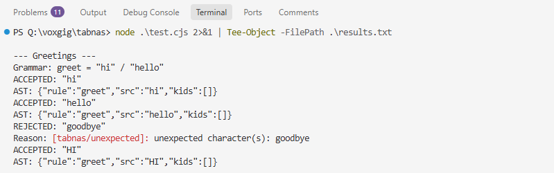
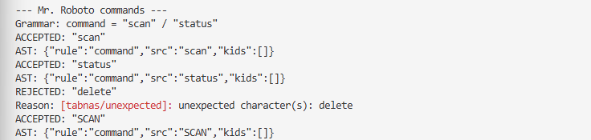

# Exploring Tabnas: A Simple Command Parser Experiment

*By Wisdom Kinoti*

## Why I chose Tabnas

During my Computer Science studies, I enjoyed Assembly Language and Compiler Construction. One thing that interested me was how computers understand instructions written in programming languages.

That interest also influenced a personal project of mine called **Mr. Roboto**, a command-line utility for Windows and Linux. I previously considered developing a native Windows application for it, although I haven't completed that direction.

When I came across [Tabnas](https://tabnas.dev/), I was curious about its approach to parsing. Some of its concepts reminded me of what I had studied in compiler construction.

I had never used Tabnas before, so instead of exploring every feature, I decided to start with something small.

**Could I use Tabnas to recognize a few commands without building my own parser?**

## What is Tabnas?

Tabnas is an open-source parsing engine that lets developers define rules for recognizing structured input.

A parser checks whether input follows the grammar of a language.

For example, imagine an application that accepts two commands:

- `scan` — intended to start a scanning operation.
- `status` — intended to display the application's current state.

If someone enters `delete`, the parser should reject it because it isn't part of the defined grammar.

For a small application, ordinary JavaScript conditions could handle this. But as the command structure grows, with arguments, options and different combinations, defining a grammar becomes more interesting.

Tabnas separates the parsing engine from the grammar supplied to it.

It also supports **ABNF (Augmented Backus–Naur Form)** through the `@tabnas/abnf` package.

ABNF is a notation for describing grammar rules. Instead of writing all the recognition logic manually, you can define what valid input should look like.

## Setting up my experiment

I used Node.js on Windows and installed the packages:

```powershell
npm install @tabnas/parser @tabnas/abnf
```

The versions installed were:

- `@tabnas/parser@0.12.15`
- `@tabnas/abnf@0.4.25`

I created a JavaScript file called `test.cjs`.

The script initializes a parser, loads a grammar, processes several inputs and displays whether each was accepted or rejected.

Here is the code I ran:

```javascript
const { Tabnas } = require('@tabnas/parser')
const { abnf } = require('@tabnas/abnf')

function testGrammar(name, grammar, inputs) {
    const parser = new Tabnas({ plugins: [abnf] })
    parser.abnf(grammar)

    console.log(`\n--- ${name} ---`)
    console.log(`Grammar: ${grammar}`)

    for (const input of inputs) {
        try {
            const result = parser.parse(input)
            console.log(`ACCEPTED: ${JSON.stringify(input)}`)
            console.log('AST:', JSON.stringify(result))
        } catch (error) {
            console.log(`REJECTED: ${JSON.stringify(input)}`)
            console.log('Reason:', error.message.split('\n')[0])
        }
    }
}

testGrammar(
    'Greetings',
    'greet = "hi" / "hello"',
    ['hi', 'hello', 'goodbye', 'HI']
)

testGrammar(
    'Mr. Roboto commands',
    'command = "scan" / "status"',
    ['scan', 'status', 'delete', 'SCAN']
)
```

## Testing the first grammar

My first grammar was:

```text
greet = "hi" / "hello"
```

It defines two valid alternatives: `hi` and `hello`.

I tested four inputs.

| Input | Result |
| ----------- | -------- |
| `hi` | Accepted |
| `hello` | Accepted |
| `goodbye` | Rejected |
| `HI` | Accepted |

For the input `hi`, Tabnas returned:

```json
{"rule":"greet","src":"hi","kids":[]}
```

The result contains the rule that matched, the source text and an array of child nodes.

The `kids` array was empty because this was a simple grammar without nested sub-rules in the returned result.

I also noticed that `HI` was accepted even though the grammar specified lowercase `hi`.

According to the [Tabnas ABNF documentation](https://github.com/tabnas/abnf#readme), ordinary quoted string literals are case-insensitive by default.



*Figure 1: Greeting grammar results — three accepted inputs and one rejected input.*

## Testing hypothetical Mr. Roboto commands

For the second experiment, I wanted something closer to an application I could relate to.

I used two hypothetical commands for Mr. Roboto:

```text
command = "scan" / "status"
```

The script created a separate parser for this grammar and tested four inputs.

| Command | Result |
| ---------- | -------- |
| `scan` | Accepted |
| `status` | Accepted |
| `delete` | Rejected |
| `SCAN` | Accepted |

For the accepted command `scan`, the parser returned:

```json
{"rule":"command","src":"scan","kids":[]}
```

For `delete`, the script displayed:

```text
[tabnas/unexpected]: unexpected character(s): delete
```

One important detail is that my script displayed only the first line of the error message, not the complete diagnostic.



*Figure 2: Hypothetical Mr. Roboto command tests and installed Tabnas versions.*

These commands were only part of the standalone experiment. **I did not integrate Tabnas into Mr. Roboto.**

Across the two grammars, I tested eight inputs: six were accepted and two were rejected.

## What I learned

The first useful lesson was how a simple grammar could describe accepted inputs without requiring me to implement the parsing engine.

For example:

```text
command = "scan" / "status"
```

This is a short way to express the two commands the parser should recognize.

I also got to see the structure returned when parsing succeeds. The results included `rule`, `src` and `kids`.

My examples were simple, so they didn't demonstrate complex syntax trees. Still, they helped connect the concept of parsing to actual code.

Another observation was case-insensitive matching. The parser accepted both `scan` and `SCAN`.

For a command-line utility, that behavior might be convenient. However, different applications may require different rules about capitalization.

The experiment also highlighted the difference between **recognizing a command and executing it**.

Tabnas accepted `scan`, but it did not perform a scan. Implementing that behavior would be the responsibility of the application using the parser.

## What I would question

My main question is whether a parsing library is necessary for a small command-line application.

If an application only needs to recognize two commands, a few conditional statements would probably be easier to maintain than introducing a separate parsing dependency.

For more complicated command structures, however, defining a grammar might become more useful.

That is a trade-off I would want to consider before choosing Tabnas for an actual project.

I would also investigate error handling more closely.

My experiment confirmed that invalid inputs produced errors, but because the script displayed only the first line of each error message, I cannot make a fair judgment about the quality of the complete diagnostics.

Another limitation is the scope of my testing. I haven't tested complex grammars, custom parsing actions, performance, or the lower-level rule tables described in Tabnas's documentation.

I therefore cannot judge how well those features work from this experiment.

## Final thoughts

My first experience with Tabnas was a small but useful exercise.

I started with a greeting grammar and then tested hypothetical commands based on Mr. Roboto. Both grammars accepted and rejected the inputs as expected.

What interested me most was seeing a concept from compiler construction work in a practical JavaScript example.

I wouldn't introduce a parsing framework into every command-line project. For simple input matching, ordinary conditions may be enough.

But if I needed to build a more structured command language, Tabnas would be worth exploring further.

My next experiment would be to define commands with arguments, inspect more complex syntax trees and understand how parsing actions work.

For now, my conclusion is straightforward: **Tabnas worked for the simple grammars I tested, but this experiment alone isn't enough to judge its suitability for a larger application.**

That distinction matters to me. A tool can work well in a small demonstration without automatically being the best choice for every project.
